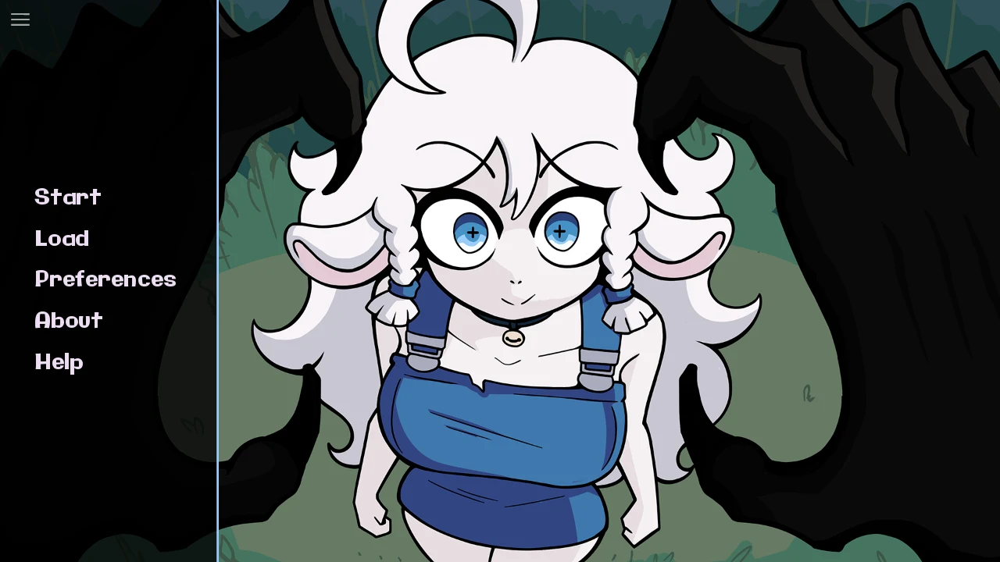
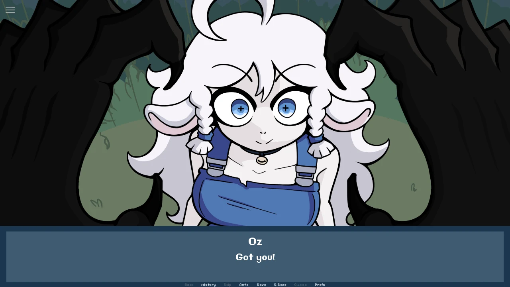

# Best Friends for Dinner!

[Play and explore Best Friends for Dinner](https://bestfriendsfordinner.online/)

A short story, an unlikely friendship, and something unsettling beneath the surface. Discover Demonward’s visual novel through an independent browser-game hub with illustrated background information, real game-interface images and practical help.

## Take your seat

- Open the browser game from a clear, one-click play screen.
- Meet Donna and Oz through a spoiler-light introduction.
- Explore an image gallery with enlarged views and optional horror imagery.
- Follow the [illustrated beginner guide](https://bestfriendsfordinner.online/guides/) for dialogue controls, settings and loading help.
- Watch two selected videos, or share the website with a friend.
- Use Install App for a convenient return shortcut. The game and videos still require an internet connection.

## Before you play

The story includes implied violence, poisoning, bullying and unsettling dark humor. Videos may contain spoilers. Browser compatibility and local saves depend on the hosted game and your device.

The game and artwork belong to Demonward and their respective owners. This website is independently operated and is not affiliated with or endorsed by the creator.

[Original game by Demonward](https://demonward.itch.io/best-friends-for-dinner) · [About Us](https://bestfriendsfordinner.online/about/) · [Contact](https://bestfriendsfordinner.online/contact/) · [Privacy Policy](https://bestfriendsfordinner.online/privacy/) · [Terms of Service](https://bestfriendsfordinner.online/terms/)
